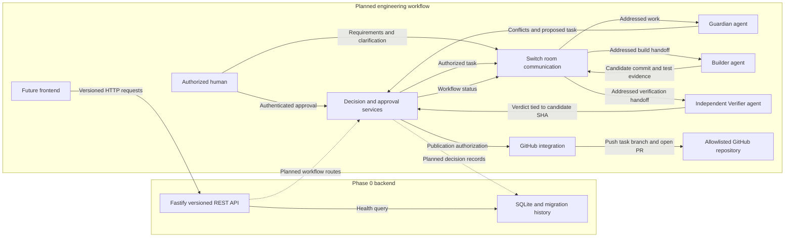

# DriftGuard architecture

Phase 0 implements the Fastify API, validated configuration, structured logs, and SQLite migrations. Phase 1 adds persistent task identities, human assignment, role-specific access, and Switch handoff payloads. Switch room delivery and GitHub publication are separate from the local authorization record. See [phase progress](PHASE_PROGRESS.md) for verified runtime behavior.

## Implemented foundation

- `src/app/` starts and stops Fastify. Pino emits structured logs and includes request IDs on request logs. `src/config/` loads `.env` and validates configuration before startup.
- `src/db/` owns the SQLite connection and migration history. Startup checks the application ID and applies pending migrations inside an immediate transaction. Keep applied migrations immutable and append new ones with increasing versions.
- `src/api/` owns HTTP routes and the JSON error envelope. `GET /api/v1/health` queries SQLite and returns `503` if the check fails.

## Planned boundaries

| Component | Responsibility |
| --- | --- |
| Switch room communication | Deliver requirements, clarification, and addressed handoffs through a real Switch room. Treat message bodies and attachments as untrusted input. |
| Guardian agent | Compare requirements, surface conflicts and missing acceptance criteria, and propose a task for review. |
| Decision and approval services | Record decisions and enforce the repository allowlist and human authorization in application code. Bind authorization and verification evidence to the relevant task, repository, and candidate revision. |
| Builder agent | Work on the authorized task in an isolated workspace, use a task-specific branch, and record the actual changes and checks it ran. |
| GitHub integration | Resolve repository and branch identities, enforce write prerequisites, and publish the authorized branch and pull request. A human reviews and merges the PR. |
| Independent Verifier agent | Inspect the candidate commit from a clean checkout and run applicable checks independently of the Builder. Return evidence tied to the exact candidate SHA. |
| Future frontend API | Expose versioned REST contracts for status and authorized operator actions. Keep authentication, approval, and audit decisions on the backend. |

The reserved source and Switch directories establish ownership for this later work. Repository files, issue content, chat input, and agent output all cross a trust boundary. The application must validate them and constrain workspace access before executing commands or changing a repository.
